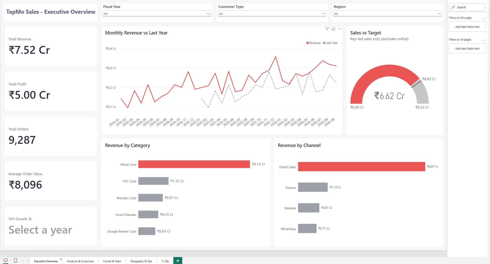
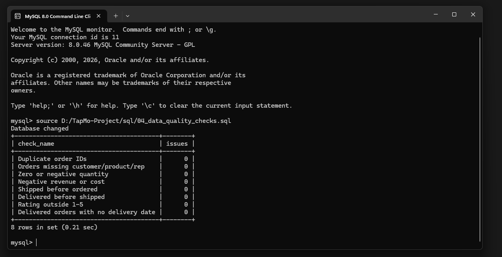
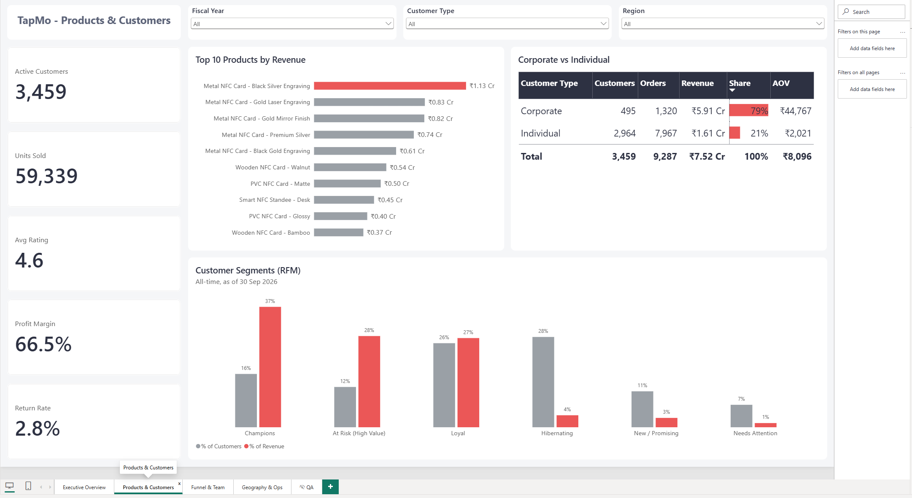
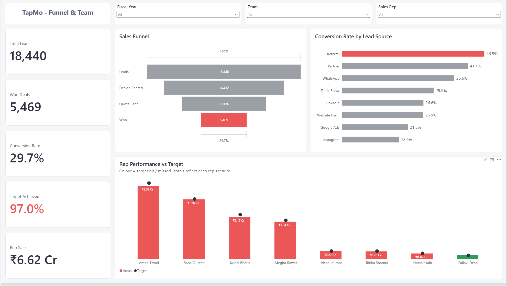
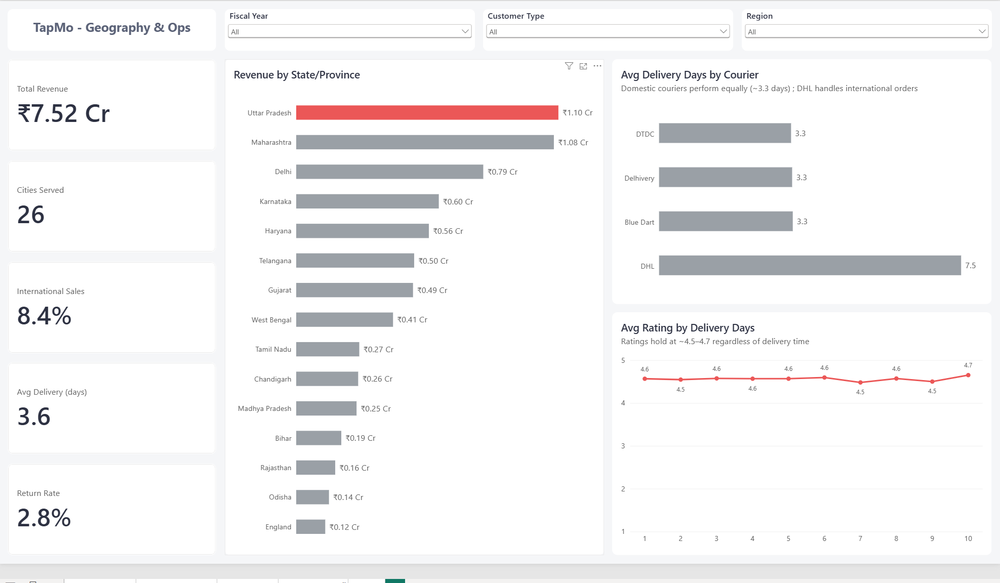

# TapMo Sales Analytics — MySQL + Power BI

End-to-end sales analytics for **TapMo India**, an NFC smart business card brand: a MySQL star schema, SQL views for cleaning and analysis, and a 4-page Power BI dashboard covering revenue, products, customers, the sales funnel, team targets and operations.

> **Note:** the dataset is synthetic (Jan 2024 – Sep 2026), generated to mirror a real D2C + B2B business. All figures below come from that data.



---

## Headline numbers

| Metric | Value |
|---|---|
| Total revenue | **₹7.52 Cr** |
| Total profit | **₹5.00 Cr** (66.5% margin) |
| Orders | **9,287** (excl. 227 cancelled) |
| Active customers | **3,459** |
| Leads → won deals | **18,440 → 5,469** (29.7% conversion) |
| Rep target achievement | **97.0%** |

## Key insights

1. **Corporate clients drive the business** – They are 14% of customers (495) but **79% of revenue**, with an average order value of **₹44,767 vs ₹2,021** for individuals (~22×).
2. **Metal cards dominate** – Metal is **55%** of revenue (₹4.13 Cr), and the top 5 products are all Metal NFC cards.
3. **A small group of customers carries the revenue** – RFM segmentation shows **Champions are 16% of customers but 37% of revenue**.
4. **High-value customers are slipping away** – "At Risk (High Value)" customers are 12% of the base but **28% of revenue**, making them the clearest win-back opportunity.
5. **Referrals convert best** – Referral leads convert at **46.5%**, about **2.5× Instagram (18.6%)**, which makes a case for shifting spend toward referral incentives.
6. **Targets were narrowly missed** – The team reached **97%** of target, and 7 of 8 reps finished within a few percent of theirs, which suggests targets were ambitious rather than performance poor.
7. **Delivery speed doesn't drive ratings** – Average rating holds at **4.5–4.7** whether delivery takes 1 or 10 days. The three domestic couriers perform equally (~3.3 days); DHL (~7.5 days) handles international orders only.
8. **Growth is steady** – Revenue sits above the previous year in most months, with a clear **December peak** each year.

---

## Tools

- **MySQL 8**: schema design, data loading, cleaning views, data-quality checks
- **Power BI Desktop**: data model, DAX measures, report design
- **DAX**: time intelligence, ranking, share-of-total and conditional-formatting measures

## Repository structure

```
TapMo-Project/
├── sql/
│   ├── 01_schema.sql               # star schema with PK/FK constraints
│   ├── 02_load_data.sql            # synthetic data (dimensions + facts)
│   ├── 03_views.sql                # cleaning + analysis views
│   └── 04_data_quality_checks.sql  # validation queries
├── powerbi/
│   ├── TapMo_Sales_Dashboard.pbix  # the report
│   └── TapMo_Theme.json            # custom colour theme
├── screenshots/                    # dashboard pages + DQ results
└── README.md
```

## Data model

A **star schema** in MySQL (`tapmo` database):

| Type | Tables |
|---|---|
| Dimensions | `dim_date` (incl. Indian fiscal year Apr–Mar), `dim_product` (14 products), `dim_customer` (4,200 customers), `dim_sales_rep` (8 reps + online) |
| Facts | `fact_orders` (9,514 rows), `fact_leads`, `fact_targets` (monthly targets per rep), `fact_profile_engagement` |
| Views | `vw_sales_clean`, `vw_monthly_kpis`, `vw_lead_funnel`, `vw_rep_vs_target`, `vw_customer_cohorts`, `vw_rfm_segments` |

Power BI imports the dimensions and views, with `dim_date` marked as the date table.

## Data preparation & validation

Because the data is synthetic, it didn't need heavy cleaning. The work was in **preparing and validating** it:

- **Integrity built in** – Primary and foreign keys mean an order can't reference a customer, product, rep or date that doesn't exist.
- **A cleaning layer (`vw_sales_clean`)** – It excludes cancelled orders, derives profit and margin %, and adds a returned-order flag.
- **Deliberate NULL handling** – Delivery fields stay NULL for unshipped orders, and months with no rep sales show 0 via `COALESCE`.
- **Business rules** – Online self-serve orders are excluded from rep target tracking, because no rep owns them.
- **Data-quality checks (`04_data_quality_checks.sql`)** – Eight checks cover duplicate IDs, missing keys, non-positive quantities, negative revenue or cost, and impossible date order. All returned **0 issues**:

  

- **SQL ↔ DAX reconciliation** – DAX month-over-month growth matches the SQL view exactly (e.g. Feb-24 −32.5%, Mar-24 +93.0%), and category and channel totals both reconcile to ₹7.52 Cr. A hidden QA page in the report holds these checks.

---

## Dashboard pages

Every page shares one layout grid (1920×1080, 16 px margins), a five-card KPI rail and one colour rule: **red = the leader or current period, grey = comparison**.

### 1. Executive Overview
Revenue, profit, orders, AOV and YoY growth. A monthly revenue vs last-year trend, a sales vs target gauge, and revenue by category and by channel.

### 2. Products & Customers

Top 10 products, a Corporate vs Individual comparison table with revenue-share data bars, and RFM segments comparing % of customers with % of revenue.

### 3. Funnel & Team

A lead funnel (Leads → Design Shared → Quote Sent → Won), conversion by lead source, and rep performance vs target, with each rep coloured by whether they hit their target. The slicers are rep-based (Team, Sales Rep) so they filter both the lead and target data.

### 4. Geography & Ops

Revenue by state/province, international share, average delivery days by courier, and rating vs delivery time.

---

## DAX techniques used

| Technique | Where | Why |
|---|---|---|
| `RANKX` + `ALLSELECTED` colour measures | Top product, top lead source, top state | Highlights the #1 bar dynamically, so the highlight still follows the leader when slicers change the ranking |
| `CALCULATE` + `KEEPFILTERS` | International Share % | Adds the "International" condition *on top of* the Region slicer instead of overriding it |
| Share of total with `ALLSELECTED` | Revenue Share %, RFM % of customers/revenue | Each segment's share of whatever is currently selected |
| `HASONEVALUE` guard | YoY Growth % | Shows YoY only when a single fiscal year is selected |
| Dynamic blank labels | YoY card | Shows "Select a year" or "No prior year" instead of a blank |
| `SWITCH(TRUE())` colour measures | YoY, Target Achieved | Green / red / grey based on the value |
| `FORMAT` + `COALESCE` card measures | Orders, AOV, Leads, Won | Shows exact values (9,287, not "9K"), and 0 instead of blank |
| Time intelligence | Revenue PY, MoM, FYTD | Year-over-year and fiscal year-to-date comparisons |

## Design decisions

- **Bar charts instead of maps** – They give a more precise comparison and avoid geocoding errors with Indian place names.
- **Removing a highlight when there is no leader** – The domestic couriers are tied, so highlighting one would overstate the difference.
- **Making scope explicit** – The RFM chart is all-time and doesn't respond to the year slicer. The target gauge covers rep-led sales only, so the Region and Customer Type interactions are turned off for it. Subtitles say so on the page.

## How to run

1. In the MySQL 8 command line client, run the scripts in order:
   ```
   source path/to/sql/01_schema.sql
   source path/to/sql/02_load_data.sql
   source path/to/sql/03_views.sql
   source path/to/sql/04_data_quality_checks.sql
   ```
2. Open `powerbi/TapMo_Sales_Dashboard.pbix` in Power BI Desktop.
3. If prompted, update the MySQL data source credentials (**Transform data → Data source settings**) and refresh.

---

**Author:** Akshat Srivastava · [Portfolio](https://akshatsrivastava-eight.vercel.app/)
